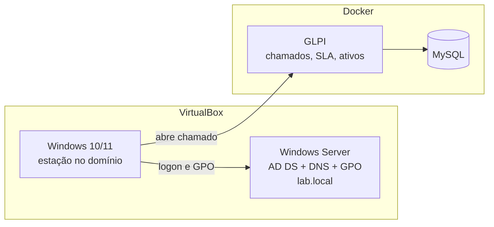

# Laboratório de Suporte de TI

Ambiente de laboratório que reproduz a rotina de um service desk: domínio Active Directory com usuários, grupos e políticas, ferramenta de chamados GLPI com SLA e base de conhecimento, e scripts PowerShell para os atendimentos mais comuns de N1.

## O que tem aqui

| Pasta | Conteúdo |
|---|---|
| `ad/` | Criação do domínio, OUs por setor, grupos, usuários via CSV, política de senha, GPOs de bloqueio de tela e de USB, e funções de N1 (reset de senha, desbloqueio, acesso a grupo, offboarding) com log de atendimento |
| `scripts/` | Inventário de hardware da estação, diagnóstico de rede em camadas e limpeza de temporários |
| `glpi/` | GLPI em Docker com a imagem oficial e o roteiro de configuração (categorias, SLA, grupos N1/N2, ativos) |
| `docs/` | Fluxo de atendimento baseado em ITIL 4 (incidente, requisição, problema, matriz de prioridade, SLA) e base de conhecimento |

## Arquitetura do laboratório



## Como montar

### 1. Máquinas virtuais
- VirtualBox (gratuito).
- Windows Server em versão de avaliação gratuita (Microsoft Evaluation Center).
- Windows 10/11 Enterprise em versão de avaliação para a estação.
- Rede das duas VMs em "Rede interna" ou "Rede NAT"; o DNS da estação aponta para o IP do servidor.

### 2. Active Directory (no servidor, PowerShell como Administrador)
```powershell
.\ad\01-Instalar-AD.ps1                 # cria o domínio lab.local (o servidor reinicia)
.\ad\02-Popular-AD.ps1                  # OUs, grupos e usuários do usuarios.csv
.\ad\03-Configurar-Politicas.ps1        # política de senha e GPOs
```
Depois, ingresse a estação no domínio e faça logon com um dos usuários.

### 3. Rotinas de N1
```powershell
. .\ad\04-Rotinas-N1.ps1
Get-StatusUsuario -Login ana.souza
Unlock-ContaUsuario -Login ana.souza -Chamado 1001
Reset-SenhaUsuario -Login ana.souza -Chamado 1002
Add-UsuarioGrupo -Login bruno.lima -Grupo GG_Comercial -Chamado 1003
Disable-UsuarioDesligado -Login diego.rocha -Chamado 1004
```
Cada ação fica registrada em `ad/log-atendimentos.csv`.

### 4. Scripts da estação
```powershell
.\scripts\Inventario-Maquina.ps1
.\scripts\Diagnostico-Rede.ps1
.\scripts\Limpeza-Temporarios.ps1 -WhatIf
```

### 5. GLPI
Ver [glpi/ROTEIRO.md](glpi/ROTEIRO.md).

## Evidências

Prints do ambiente funcionando ficam em [docs/evidencias](docs/evidencias).

## Validação automática

A cada push o GitHub Actions roda o PSScriptAnalyzer nos scripts PowerShell e valida o `docker-compose.yml` do GLPI.

## Autor

Matheus Ansel - [LinkedIn](https://www.linkedin.com/in/matheusansel) - [GitHub](https://github.com/MatheusAnsel) - [Portfólio](https://matheusansel.com)
