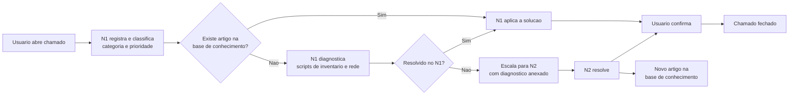

# Fluxo de atendimento (baseado em ITIL 4)

## Tipos de registro

| Tipo | O que e | Exemplo |
|---|---|---|
| Incidente | Algo que funcionava parou ou piorou | "Estou sem internet", "o Outlook nao abre" |
| Requisicao de servico | Pedido padrao, nada quebrado | Criar usuario, liberar acesso a pasta, instalar software homologado |
| Problema | Causa raiz de incidentes repetidos | Varios usuarios do mesmo andar perdendo rede toda manha |
| Mudanca | Alteracao planejada no ambiente | Trocar o switch do andar, atualizar o servidor de arquivos |

## Prioridade = Impacto x Urgencia

| | Urgencia alta | Urgencia media | Urgencia baixa |
|---|---|---|---|
| **Impacto alto** (setor inteiro ou sistema critico) | P1 - Critica | P2 - Alta | P3 - Media |
| **Impacto medio** (um grupo de usuarios) | P2 - Alta | P3 - Media | P4 - Baixa |
| **Impacto baixo** (um usuario, com contorno) | P3 - Media | P4 - Baixa | P4 - Baixa |

## SLA de referencia do laboratorio

| Prioridade | Primeiro atendimento | Solucao |
|---|---|---|
| P1 - Critica | 15 minutos | 4 horas |
| P2 - Alta | 30 minutos | 8 horas |
| P3 - Media | 2 horas | 2 dias uteis |
| P4 - Baixa | 4 horas | 5 dias uteis |

## Ciclo de vida do chamado

## Boas praticas do N1

- Registrar tudo no chamado, inclusive o que nao funcionou.
- Confirmar a identidade do usuario antes de resetar senha.
- Escalar com contexto: o que foi testado, prints, relatorio do `Diagnostico-Rede.ps1`.
- Fechar so depois da confirmacao do usuario.
- Atendimento repetido vira artigo na base de conhecimento.
